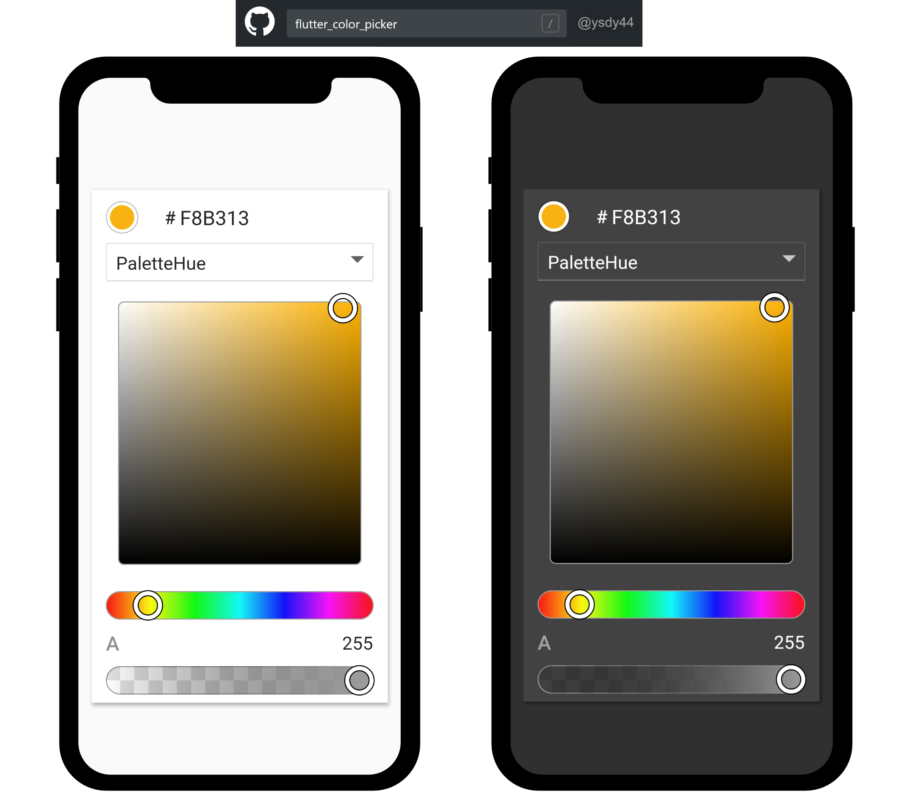
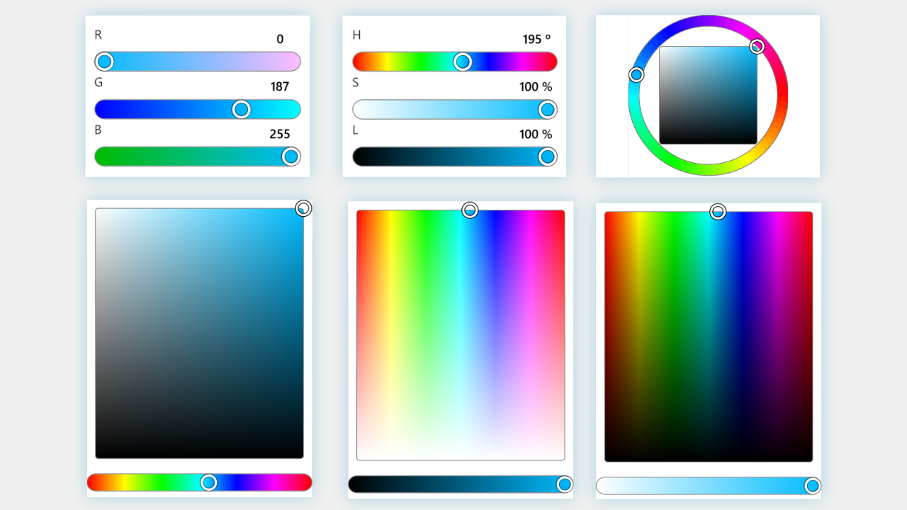

# flutter_hsvcolor_picker

An HSV color picker designed for your Flutter app.

Pickers: RGB, HSV, Color Wheel, Palette Hue, Palette Saturation, Palette Value, Swatches.



## Getting Started
  


### Installation

https://pub.dev/packages/flutter_hsvcolor_picker/install

Version 2.0.0 requires Flutter 3.47 or newer.

```yaml
dependencies:
  flutter_hsvcolor_picker: ^2.0.0
  material_ui: ^1.11.0
```

### Migrating to 2.0.0

Replace `import 'package:flutter/material.dart';` with `import 'package:material_ui/material_ui.dart';` in the app that hosts the picker. Use Material UI's `MaterialApp`, `Theme`, and `ThemeData` together so the picker inherits your app's colors and text styles. Flutter's deprecated Material themes and Material UI's themes are separate types.

For Flutter versions below 3.47, use 1.6.0:

```yaml
dependencies:
  flutter_hsvcolor_picker: ^1.6.0
```

### Example

```dart

import 'package:material_ui/material_ui.dart';
import 'package:flutter_hsvcolor_picker/flutter_hsvcolor_picker.dart';

ColorPicker(
  color: Colors.blue,
  onChanged: (value) {
    // Save the selected color in your app state.
  },
  initialPicker: Picker.paletteHue,
)
```

`color` sets the initial selection and updates it when the parent passes a new color. `initialPicker` selects the first picker only. Sliders, palettes, and the wheel accept taps and drags. Color changes start after the gesture is accepted. The HEX field accepts six RGB digits, optionally prefixed with `#` or `0x`; use the alpha slider for transparency.

For a more detailed example, head over to: https://github.com/fluttercandies/flutter_hsvcolor_picker/tree/main/example/lib/complex_example



## Development

The package and checked-in native example require Flutter 3.47 or newer.

Use FVM for the repository toolchain. The canonical formatter width is 120 columns. The Flutter 3.47 CI job checks the package; the stable job also resolves and tests the native example:

```sh
fvm dart format --page-width 120 .
fvm dart format --page-width 120 --output=none --set-exit-if-changed .
fvm dart analyze lib test
fvm flutter test
(cd example && fvm flutter build apk --debug)
```

The example also has native runner tests. Flutter 3.47 sets the checked-in example's iOS deployment target to 15.0.
Current Xcode versions require command-scoped iOS 17 and macOS 14 deployment targets for these tests:

```sh
xcodebuild test -project example/macos/Runner.xcodeproj -scheme Runner -destination 'platform=macOS,arch=arm64' \
  -parallel-testing-enabled NO -enableCodeCoverage YES -only-testing:RunnerTests MACOSX_DEPLOYMENT_TARGET=14.0
xcodebuild test -project example/ios/Runner.xcodeproj -scheme Runner \
  -destination 'platform=iOS Simulator,id=<simulator-udid>' \
  -parallel-testing-enabled NO -enableCodeCoverage YES -only-testing:RunnerTests IPHONEOS_DEPLOYMENT_TARGET=17.0
```
